# DriveSmart

**Plataforma de renta de vehículos con asistente virtual local.**

Beta construida con Python 3.12, Django 5.2 LTS, SQLite y tecnologías web nativas.
Permite explorar vehículos, comparar opciones y enviar solicitudes simuladas.
Interfaz en español, precios en MXN y PWA con catálogo público sin conexión.

> Las rentas son de demostración y no procesan pagos. Las políticas comerciales
> reales siguen pendientes de definición y aprobación.

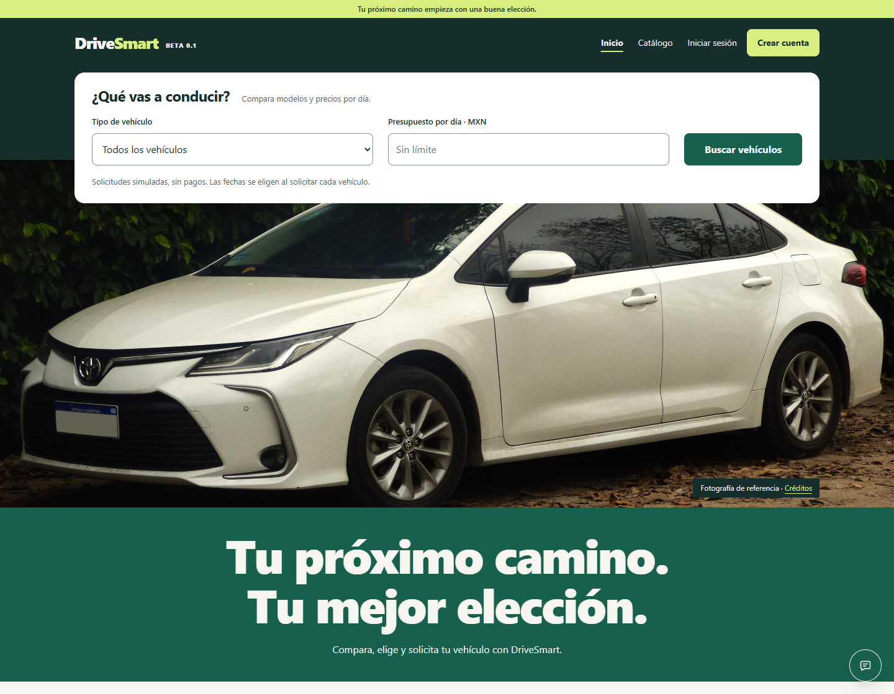

[Instalación](#instalación-local-en-windows) · [Capturas](#recorrido-visual) ·
[Arquitectura](#arquitectura) · [Asistente](#asistente-virtual) · [Pruebas](#verificación)

## Qué puedes hacer

- Explorar el catálogo con fotografías y filtros por características y presupuesto.
- Consultar la ficha de cada vehículo, su capacidad, transmisión y precio diario.
- Registrarte, iniciar sesión y consultar tus propias solicitudes.
- Elegir fechas, revisar el costo y enviar una solicitud pendiente de aprobación.
- Consultar al asistente sobre el sistema, vehículos, fechas y estimaciones.
- Administrar vehículos, rentas y respuestas de conocimiento mediante Django Admin.

Las rentas aprobadas bloquean intervalos que se superponen. Las pendientes no
reservan disponibilidad. El precio se calcula con Decimal y días entre inicio y devolución.

## Recorrido visual

Capturas reales obtenidas con **Playwright y Chrome**, usando una base temporal,
fotografías de referencia y cuentas de demostración. No muestran datos de clientes.
Los importes y fechas corresponden a esos fixtures, no a una oferta comercial.

| Catálogo y filtros | Detalle del vehículo |
| --- | --- |
| 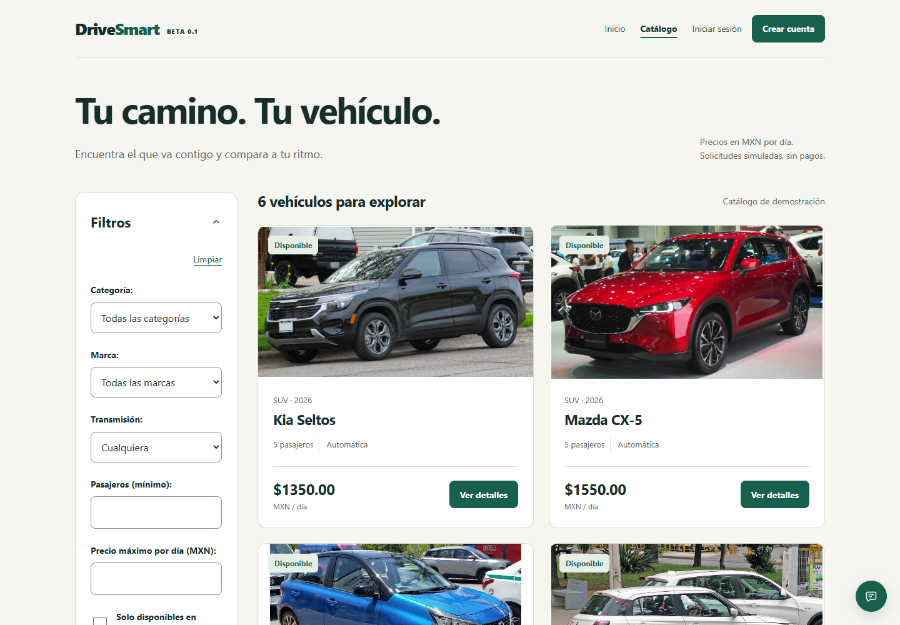 | 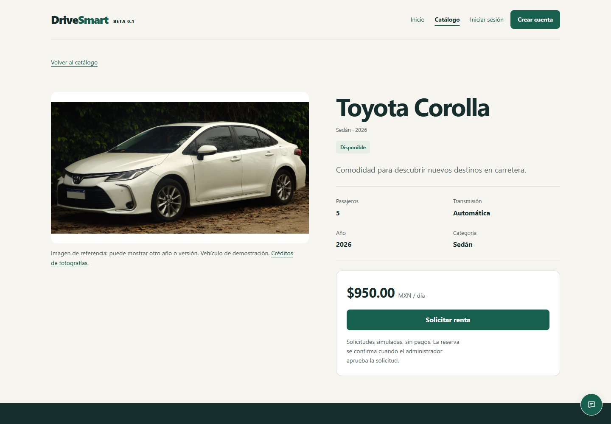 |

| Revisión de una solicitud | Asistente contextual |
| --- | --- |
| 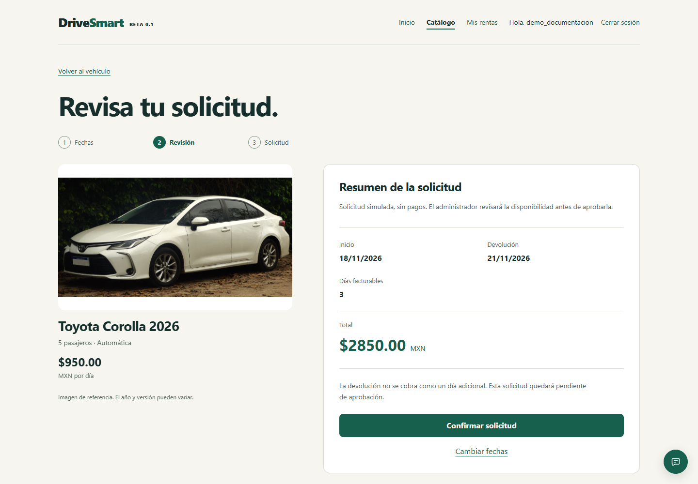 | 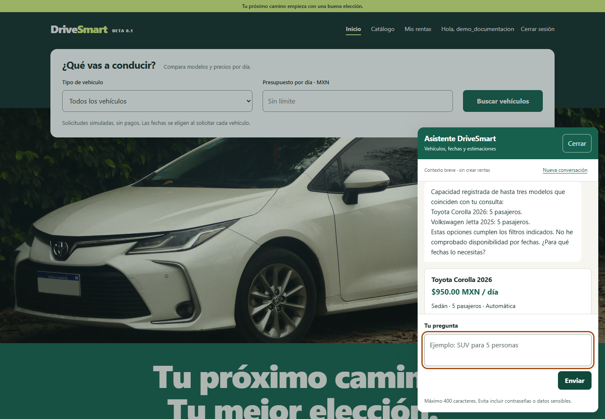 |

### En móvil

| Inicio · 390 px | Catálogo · 390 px |
| --- | --- |
| 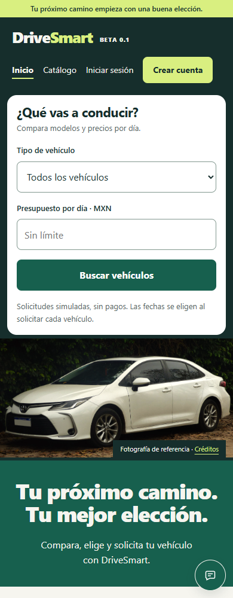 | 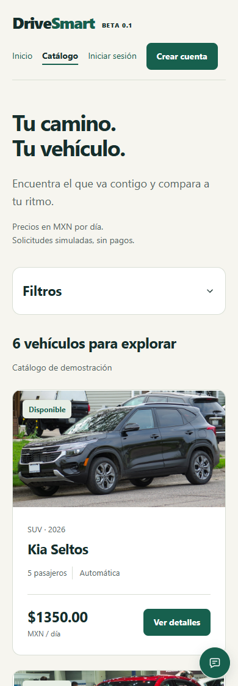 |

<details>
<summary>Ver filtro aplicado, acceso y administración</summary>

**Filtro SUV aplicado**

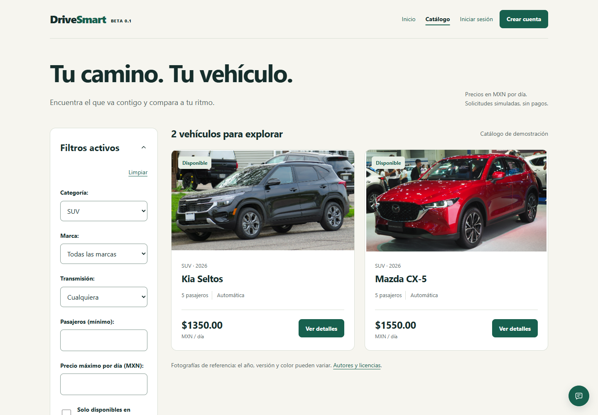

**Inicio de sesión**

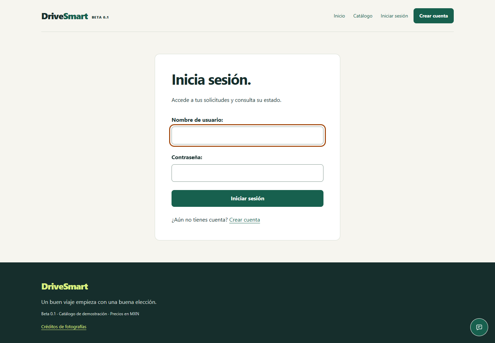

**Administración de vehículos con cuenta temporal**

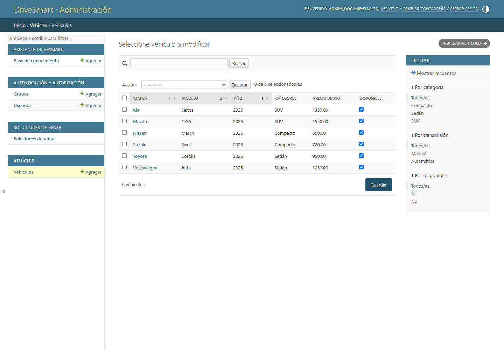

</details>

## Arquitectura

DriveSmart es un **monolito modular**: una aplicación Django reúne los dominios
del negocio y reutiliza Auth, Admin, ORM, formularios y sesiones. Templates genera
las páginas y JavaScript añade interacción al chat, filtros y registro de la PWA.


`f8b6f22`. [Descargar SVG](docs/images/arquitectura.svg) ·
[Ver PNG](docs/images/arquitectura.png).

| Módulo | Responsabilidad |
| --- | --- |
| `accounts` | Registro e integración con autenticación nativa |
| `vehicles` | Catálogo, filtros, fotografías y administración de vehículos |
| `rentals` | Solicitudes, cálculo de costos y validación de disponibilidad |
| `assistant` | Interpretación local, contexto y conocimiento administrado |
| `core` | Portada, manifiesto PWA, worker y aviso offline |
| `config` | Configuración y rutas del proyecto |

La selección de herramientas busca una instalación reproducible y pocos componentes
operativos. SQLite funciona en el servidor; guarda datos y rutas de imágenes,
mientras los archivos subidos residen en `media/`. No se necesita un servidor de
base de datos separado ni un frontend con compilación propia.

El alcance de esta beta no demuestra capacidad de producción ni alta concurrencia.
Una evolución hacia más escrituras simultáneas requeriría evaluar PostgreSQL,
transacciones y pruebas de carga. [Decisiones y evolución](docs/ARQUITECTURA_Y_ESCALABILIDAD.md).

## Asistente virtual

El chat utiliza Python estándar, normalización, sinónimos, expresiones regulares y
difflib. No depende de un LLM, una API generativa ni una base vectorial.


- Recuerda filtros, fechas e IDs durante una conversación breve en la sesión.
- Consulta precios y disponibilidad actuales y compara hasta tres vehículos.
- Calcula estimaciones; la confirmación definitiva ocurre en el formulario de renta.
- Pide aclaraciones cuando faltan fechas, vehículo o criterio de búsqueda.
- Registra preguntas desconocidas para revisión humana; los borradores no responden.
- Permite empezar una **Nueva conversación** sin cerrar la sesión.

Ejemplos: «Cómo se renta esto», «Cuántas personas caben en un sedán», «Busco una
camioneta automática para cinco personas», «¿Y el más barato?» y «Precio del Corolla tres días».

El catálogo de conocimiento contiene 307 temas y 456 formulaciones de partida:
245 publicadas sobre funciones comprobadas y 211 pendientes de políticas comerciales.
La cantidad en una instalación puede cambiar con la revisión administrativa.
El comando de carga conserva las ediciones existentes.

El intérprete tiene un vocabulario acotado: no comprende cualquier frase, no inventa
seguros o equipamiento y no crea ni aprueba rentas desde el chat.
[Conocimiento y fuentes](docs/BASE_CONOCIMIENTO.md) · [Chat 2.0](docs/CHAT_2_0_RESULTADOS.md).

## Instalación local en Windows

Con Python 3.12 instalado, abre PowerShell en la carpeta de `manage.py`:

```powershell
py -3.12 -m venv .venv
.\.venv\Scripts\python.exe -m pip install -r requirements.txt
.\.venv\Scripts\python.exe manage.py migrate
.\.venv\Scripts\python.exe manage.py load_demo
.\.venv\Scripts\python.exe manage.py load_knowledge_base
.\.venv\Scripts\python.exe manage.py load_vehicle_images
.\.venv\Scripts\python.exe manage.py runserver 127.0.0.1:8000
```

Los comandos de carga son opcionales y conservan registros existentes.
En una instalación ya preparada basta con el último comando; no borres la SQLite.
Abre **http://127.0.0.1:8000/**. Para administrar, crea una cuenta propia:

```powershell
.\.venv\Scripts\python.exe manage.py createsuperuser
```

Catálogo: `/vehiculos/` · Mis rentas: `/mis-rentas/` · Administración: `/admin/`.
No hay credenciales predeterminadas. `.env.example` documenta variables; Django
no carga automáticamente un archivo `.env`. No hace falta activar scripts ni cambiar
políticas de Windows. La aplicación no requiere Node ni Playwright para ejecutarse.
[Guía completa de instalación](INSTRUCTIONS.txt).

## PWA y privacidad

El manifiesto permite instalar la aplicación en navegadores compatibles. Al entrar
con conexión, la PWA descarga una copia pública del catálogo completo y sus fotos.
La descarga y actualización ocurren en segundo plano, sin avisos técnicos ni controles
de mantenimiento para el cliente. Después de completarse, pueden consultarse el catálogo
y sus fichas sin haber abierto cada vehículo antes. La copia se reutiliza por 30 minutos
y se renueva al recuperar la conexión.

Sin red, inicio y catálogo muestran esa copia, con fecha de guardado y precios
históricos identificados. **Verificar fechas en línea** informa que se necesita
internet para asegurar las fechas deseadas, precios actuales y disponibilidad.
No se aplican los filtros de la página en línea a la copia offline; se avisa de ello.

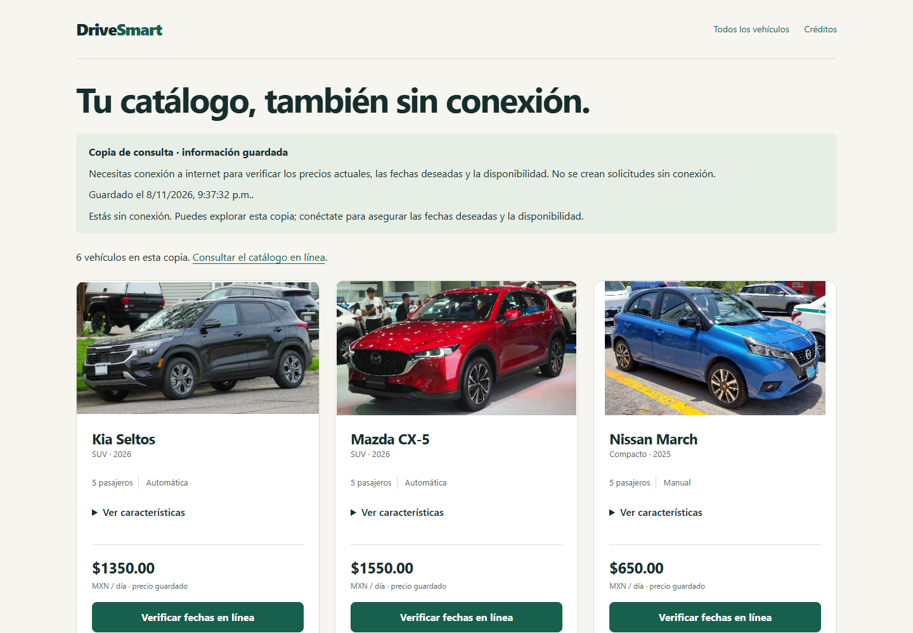

No se guarda el HTML normal con sesión: se genera una copia aislada, sin nombre,
CSRF, cuentas, rentas ni chat. Una actualización fallida conserva la última copia
completa. Se necesita una primera descarga y espacio en el navegador; si este borra
sus datos, hay que descargarla otra vez. [Funcionamiento y pruebas](docs/PWA_CATALOGO_OFFLINE.md).

Las solicitudes, el acceso a cuentas y el chat requieren conexión. No se encolan
envíos ni se promete disponibilidad desde datos guardados. El servidor de desarrollo no es un despliegue
productivo; la configuración online requiere HTTPS, secretos y endurecimiento.
[Guía de publicación](docs/PYTHONANYWHERE.md).

## Verificación

```powershell
.\.venv\Scripts\python.exe manage.py check
.\.venv\Scripts\python.exe manage.py makemigrations --check --dry-run
.\.venv\Scripts\python.exe manage.py test
```

Las pruebas Django usan datos temporales, sin modificar la SQLite de uso.
La última verificación local, con catálogo offline, aprobó **156 pruebas Django**.
La generación de estas capturas es una integración opcional independiente:
comprueba páginas, filtros, estimación, imágenes y conversación en Chrome.

Los archivos públicos del README están en **[docs/images/](docs/images/README.md)**,
con rutas relativas para que funcionen en GitHub y en una copia local. Allí se
documentan las fuentes, dimensiones y créditos. Las herramientas para regenerarlos,
sus archivos auxiliares y los registros técnicos de QA se conservan como respaldo
fuera del proyecto; no se incluyen en la entrega.

## Archivos y documentación

`db.sqlite3`, `media/`, `.env`, entornos virtuales, skills y resultados locales no
deben versionarse. Las fotografías de referencia en `static/catalog/` conservan
sus autores y licencias. El script `scripts/package_beta.py` prepara una entrega
limpia sin esos datos locales; no es necesario generar un ZIP para ejecutar el sitio.

[Progreso](docs/PROGRESO.md) · [Licencias de imágenes](docs/IMAGENES.md) ·
[Criterios visuales](DESIGN.md) · [Documentación de capturas](docs/images/README.md).
