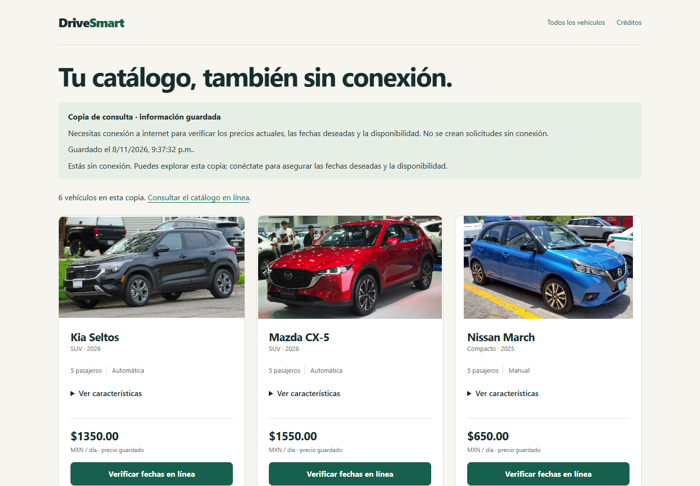

# PWA: catálogo público sin conexión

Ampliación autorizada por el usuario: consultar todo el catálogo y sus fichas sin
red, indicando que las fechas deseadas, disponibilidad y precios actuales requieren
verificación en línea. Implementación local; aún no publicada en el hosting.

## Qué verá el usuario

1. Entrar con conexión y esperar **Catálogo listo sin conexión**. Se descargan todos
   los registros del catálogo y sus fotos, no solo los vehículos visitados.
2. Sin conexión, abrir inicio, catálogo o una ficha. Se muestra la copia pública,
   con su fecha y precios identificados como guardados.
3. **Ver características** muestra descripción y estado al guardar; una ficha que
   no estaba en esa copia solicita conexión en lugar de inventar un vehículo.
4. **Verificar fechas en línea** explica la necesidad de internet sin crear ni
   encolar solicitudes. Con red conduce al formulario existente y sus validaciones.
5. Al reconectar puede renovarse con **Actualizar catálogo guardado**. La descarga
   automática reutiliza la copia por 30 minutos; la actualización explícita la renueva.

Los parámetros de filtros en línea no se aplican en esta versión offline: se muestra
todo el catálogo con un aviso, para no aparentar que se cumplen condiciones ignoradas.



## Cómo se protege la privacidad

`/catalogo-sin-conexion/` es una vista exclusivamente pública. Renderiza una plantilla
independiente sin pasar request: no incluye usuario, CSRF, sesión, formulario de renta,
solicitudes ni widget del asistente. Incluye únicamente información ya pública de
Vehicle y los créditos de fotos. Las páginas normales conservan no-store, private.

El worker v10 guarda esa respuesta identificada con una cabecera específica. La
descarga del HTML y sus fotos omite credenciales. Las imágenes se restringen al mismo
origen y a rutas públicas previstas; una URL externa del campo de imagen utiliza la
ilustración de respaldo. No existe una caché genérica de media ni de páginas navegadas.

Cada actualización se prepara en una caché nueva. Solo se publica después de descargar
el catálogo y todas sus fotos. Si falla red, una foto o el almacenamiento, se retira
la copia parcial y se conserva la anterior. La fecha corresponde a los datos guardados,
no a una supuesta consulta de disponibilidad actual.

No se cachean páginas privadas, POST, sesiones ni JSON del chat. Una navegación privada
sin red recibe únicamente un aviso genérico 503, sin datos del usuario. Los POST
fallan por red; no se envían automáticamente después. No cambian modelos, permisos,
precios, aprobación de solicitudes ni reglas de disponibilidad.

## Límites

- Se necesita visitar primero con red y completar la descarga en ese dispositivo.
- El navegador puede borrar los datos o rechazar la copia por falta de espacio.
- La copia no garantiza stock, precios vigentes ni aprobación de fechas.
- Las fotos grandes y un catálogo amplio aumentan descarga y almacenamiento.
- Catálogo offline y filtros en línea tienen alcances distintos, indicados en pantalla.
- No se valida funcionamiento físico en todos los teléfonos; se probó Chrome y viewport móvil.

## Verificación ejecutada

- 156/156 pruebas Django, ocho nuevas de contenido público, ausencia de CSRF/usuario,
  todas las filas, escape de texto, fotos permitidas y restricción de métodos.
- 2/2 integraciones Playwright: PWA y chat existente, con SQLite y media temporales.
- PWA: diez comprobaciones de descarga, seis fotografías no visitadas, ficha offline,
  actualización fallida, aviso de filtros, rutas privadas, POST sin red, reconexión y móvil.
- Chat: 18 comprobaciones de regresión, incluida actualización a v10.
- Sin migraciones pendientes. Capturas y registros técnicos en TEMP, con prefijo
  `DriveSmart_offline_`; se publican solo dos capturas anónimas en docs/images.

Prueba opcional, si está disponible el módulo Playwright de QA:

```powershell
$env:DRIVESMART_PLAYWRIGHT_MODULE="<ruta al módulo playwright/index.mjs>"
.\.venv\Scripts\python.exe manage.py test core.pwa_browser_qa assistant.browser_qa --verbosity 1
```

## Publicación posterior

Esta etapa no hace push ni modifica PythonAnywhere. Para reflejar el cambio en el
sitio publicado, primero debe actualizarse su código y los estáticos mediante el
procedimiento habitual (`collectstatic`, recarga WSGI y comprobación). Después abrir
de nuevo o recargar la PWA y esperar el aviso de catálogo guardado. Los dispositivos
que solo tengan la versión anterior no adquieren esta función antes de conectarse
y actualizar su Service Worker. Ver [guía de hosting](PYTHONANYWHERE.md).

Referencias: [Service Workers](https://developer.mozilla.org/en-US/docs/Web/API/Service_Worker_API/Using_Service_Workers)
y [Cache.put](https://developer.mozilla.org/en-US/docs/Web/API/Cache/put).
